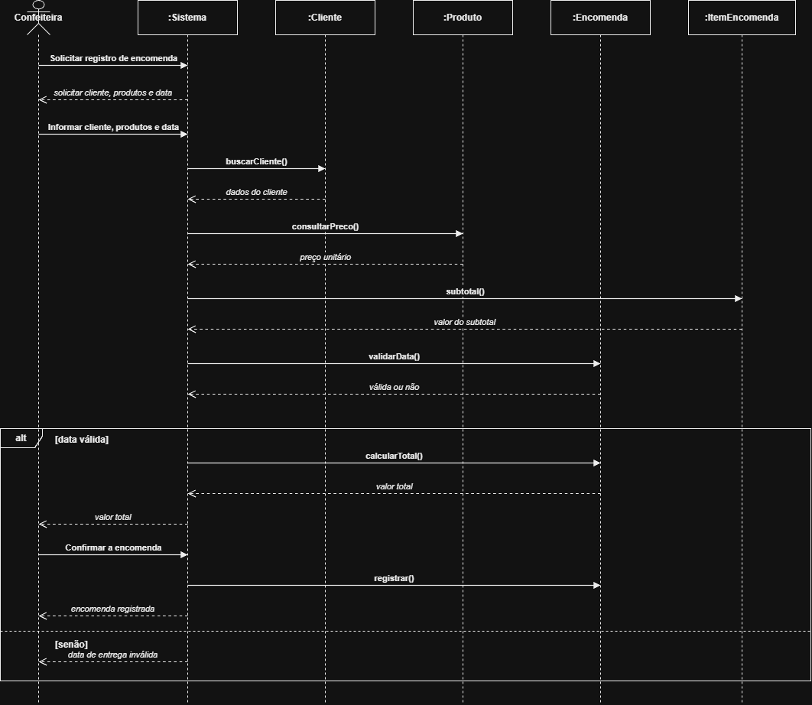

# 4.2.4 Modelagem de Sequência

## Do fluxo às mensagens

O diagrama de sequência abaixo detalha o cenário principal e a exceção de data inválida do caso de uso **UC03 - Registrar Encomenda** da seção 4.2.2, conectando o ator **Confeiteira** e o **:Sistema** às classes definidas na seção 4.2.3.

| No fluxo da 4.2.2 | Vira a mensagem | De quem para quem | Por quê |
| :--- | :--- | :--- | :--- |
| Passo 1: A confeiteira solicita o registro de uma nova encomenda. | Solicitar registro de encomenda | Confeiteira -> :Sistema | Passo do ator iniciando a interação na tela. |
| Passo 2: O sistema solicita a identificação do cliente, os produtos desejados e a data de entrega. | solicitar cliente, produtos e data | :Sistema -> Confeiteira | Resposta visual da interface solicitando os dados. |
| Passo 3: A confeiteira informa o cliente, seleciona os produtos com suas quantidades e informa a data/hora de entrega. | Informar cliente, produtos e data | Confeiteira -> :Sistema | Passo do ator enviando os dados preenchidos para o sistema. |
| Passo 4 (dados): O sistema recupera os dados do cliente e o preço dos produtos. | `buscarCliente()` e `consultarPreco()` | :Sistema -> :Cliente e :Sistema -> :Produto | As classes `Cliente` e `Produto` detêm os dados cadastrais e preços unitários. |
| Passo 4 (cálculo): O sistema calcula o valor total. | `subtotal()` e `calcularTotal()` | :Sistema -> :ItemEncomenda e :Sistema -> :Encomenda | As classes `ItemEncomenda` e `Encomenda` possuem os dados e operações de cálculo na 4.2.3. |
| Passo 4 (validação): ...e valida se a data de entrega é futura. | `validarData()` | :Sistema -> :Encomenda | A classe `Encomenda` guarda a `dataHoraEntrega` e deve validar se é futura. |
| Passo 5: A confeiteira confirma o registro da encomenda. | Confirmar a encomenda | Confeiteira -> :Sistema | Passo do ator confirmando a operação (dentro de `[data válida]`). |
| Passo 6: O sistema grava a encomenda e exibe mensagem de sucesso. | `registrar()` | :Sistema -> :Encomenda | A classe `Encomenda` persiste o registro e o sistema retorna a confirmação ao ator. |
| EX01: Se a data de entrega informada for anterior à data/hora atual, o sistema exibe alerta. | data de entrega inválida | :Sistema -> Confeiteira | Fluxo alternativo no andar inferior `[senão]` do fragmento `alt`. |

## Diagrama de sequência

**Figura 4 - Diagrama de sequência de UC03 - Registrar Encomenda**

Fonte: Autoria própria (2026).

A figura apresenta seis linhas de vida: o ator `Confeiteira`, a tela `:Sistema` e as classes `:Cliente`, `:Produto`, `:Encomenda` e `:ItemEncomenda`. A conversa ocorre de cima para baixo, passando pela consulta ao cliente e preço do produto, cálculos de subtotal e validação da data, dividindo-se no fragmento `alt` entre `[data válida]` (que calcula o total, exibe para confirmação e conclui o registro) e `[senão]` (que retorna o alerta de data inválida).

## Rastreabilidade com a 4.2.3

| Mensagem | Chega em | Operação na 4.2.3 | Passo da 4.2.2 |
| :--- | :--- | :--- | :--- |
| `buscarCliente()` | :Cliente | *Não existe na 4.2.3* | Passo 4 |
| `consultarPreco()` | :Produto | *Não existe na 4.2.3* | Passo 4 |
| `subtotal()` | :ItemEncomenda | `ItemEncomenda`, `+ subtotal(): double` | Passo 4 |
| `validarData()` | :Encomenda | *Não existe na 4.2.3* | Passo 4 |
| `calcularTotal()` | :Encomenda | `Encomenda`, `+ calcularTotal(): double` | Passo 4 |
| `registrar()` | :Encomenda | `Encomenda`, `+ registrar(): void` | Passo 6 |
| Solicitar registro, Informar dados, Confirmar a encomenda | :Sistema | Nenhuma (ações da tela do sistema) | Passos 1, 3 e 5 |

* **Toda mensagem com parênteses chega em quem tem a operação?** Sim, todas chegam nas classes responsáveis (`:Cliente`, `:Produto`, `:ItemEncomenda` e `:Encomenda`).
* **Todo passo tem mensagem?** Sim, todos os 6 passos do fluxo principal e a exceção EX01 estão representados.
* **O que o desenho mudou (Nota para revisão da 4.2.3):** Durante a modelagem de sequência do UC03, identificou-se a necessidade de operações de consulta e validação que ainda não constavam no diagrama de classes da seção 4.2.3: `+ buscarCliente(): Cliente` (em `Cliente`), `+ consultarPreco(): double` (em `Produto`) e `+ validarData(): boolean` (em `Encomenda`). Elas serão adicionadas na próxima revisão da 4.2.3.